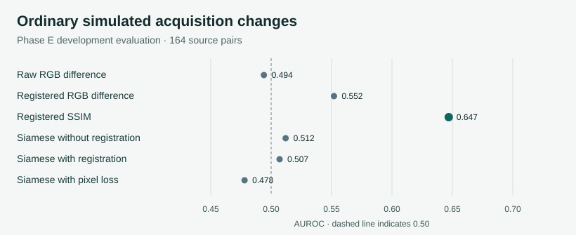

# ForgeryLens experiment summary

The [single-image receipt study ledger](SINGLE_IMAGE_RESULTS.md) indexes the newer split audit, fine-tuning comparisons, calibration and forensic-baseline access. The measurements below document the historical release.

## Evidence by partition

| Partition and task | Configuration | Recorded result | Source |
| --- | --- | --- | --- |
| Synthetic clean / shifted historical holdouts | Released local model | AUROC 0.794 / 0.512 | [Project status](PROJECT_STATUS.md) |
| Frozen AIForge in-domain / shifted holdouts | Whole-image baseline | AUROC 0.501 / 0.501 | [External results](ForgeryLens_AIForge_Results.md) |
| Frozen AIForge in-domain / shifted holdouts | Local teacher | AUROC 0.500 / 0.504, mask IoU 0.022 / 0.026 | [External results](ForgeryLens_AIForge_Results.md) |
| A, 24 training pairs, epoch 80 | Original joint loss → width 24 and batch 8 | Training AUROC 0.568 → 0.828 | [Phase A](MODEL_FAILURE_ANALYSIS.md) |
| A, 228 development-validation pairs | Width 24 and batch 8 | AUROC 0.501 | [Phase A](MODEL_FAILURE_ANALYSIS.md) |
| B, 228 development-validation pairs, annotation-guided crops | Tight 112px / contextual 224px | AUROC 0.574 ± 0.019 / 0.531 ± 0.013 across three seeds | [Phase B](PATCH_EVIDENCE_ANALYSIS.md) |
| B, 64 development-validation pairs, image-only tiles | Max-pool PatchNet | AUROC 0.520, hit@1 12.5% | [Phase B](PATCH_EVIDENCE_ANALYSIS.md) |
| C, 64 development-validation pairs | Random background negatives, seed 42 | Max AUROC 0.504, hit@1 31.3%, hit@3 56.3% | [Phase C](HARD_NEGATIVE_ANALYSIS.md) |
| C, 64 development-validation pairs | Mined negatives, seed 42 | Top-3 AUROC 0.521 | [Phase C](HARD_NEGATIVE_ANALYSIS.md) |
| D, 228 development-validation pairs | PatchNet, max pooling / attention seeds | AUROC 0.503 / 0.503–0.510 | [Phase D](MIL_ANALYSIS.md) |
| D, 228 development-validation pairs | MobileNetV3 attention, random / ImageNet | AUROC 0.500 / 0.507, seed 42 | [Phase D](MIL_ANALYSIS.md) |
| E, 164 development-validation pairs | Registered SSIM, exact / ordinary / difficult | AUROC 1.000 / 0.647 / 0.600, IoU 0.619 / 0.104 / 0.051 | [Phase E](REFERENCE_VERIFICATION_ANALYSIS.md) |
| F, independent real-world evaluation | Frozen registered SSIM | No independent results available | [Phase F](REAL_WORLD_VERIFICATION_ANALYSIS.md) |

The Phase E ordinary simulation used the same validation subset for each method below. The nominal 5%-FPR cutoff reached 6.7% recall at 4.9% actual FPR for registered SSIM. Values from that simulation do not transfer to the field by assumption.

No test data was used to select settings in Phases A–G. The earlier frozen AIForge holdout results are preserved above. Development sets were reused across research phases for diagnostics and method selection, which limits generalization claims. [Full report](FINAL_RESEARCH_REPORT.md)

## Phase G local interface benchmark

100 measured sequential multipart requests, 20 per fictional fixture after one warm-up per fixture. HTTP timings include receipt of the request, bounded multipart handling, decoding, alignment, SSIM, preview encoding, JSON serialization, and response transfer over loopback. Internal timings cover decoding through preview encoding. The local Windows run used Python 3.10.10, FastAPI 0.135.1, Pillow 12.2.0, OpenCV 4.12.0, and python-multipart 0.0.32. This measures local software execution on the demonstration images.

| Fixture | HTTP median / p95 ms | Internal median / p95 ms | Observed decision |
| --- | ---: | ---: | --- |
| Unchanged | 134.59 / 145.16 | 115.53 / 124.16 | No flag, score 0.0001 |
| Localized changed total | 138.39 / 151.41 | 120.18 / 122.64 | No flag, score 0.1062 |
| Severe misalignment | 50.66 / 72.52 | 45.19 / 45.97 | Inconclusive, no score |
| Wrong reference | 151.72 / 165.56 | 134.25 / 136.97 | Flag, score 0.8948, identity known independently |
| Changed total, both images scaled to 2× | 225.69 / 236.16 | 205.41 / 221.45 | No flag, score 0.1063 |
| All local requests | **139.00 / 229.89** | — | — |

A preview-encoding microbenchmark on the changed-total pair took 34.0 ms median at PNG compression level 6 and 28.1 ms at level 3, with approximately 2.2% more PNG bytes. The final implementation uses level 3 and retains identical pixel values. The benchmark sends only the bundled fictional examples. Run `py -m research.benchmark_compare --port 8000 --repeats 20` against a local research server to reproduce.

