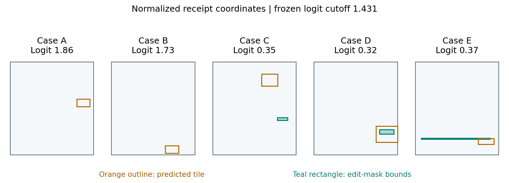

# Receipt attribution and failure cases

## Audit design

Run `receipt-explain-v1` uses the frozen residual MobileNetV3-Small checkpoint and its raw review cutoff of `1.4312477111806406`. The five focal cases come from the earlier local development case review. The deletion and background controls use the 24 matched development pairs selected by the stress protocol. All baseline logits and top tiles are checked against the saved development scores. The case classifications below refer to the raw cutoff before the demo confidence gate.

**Attribution faithfulness.** For each document, replace the highlighted tile with neutral gray. Compare its clean-to-perturbed logit drop with the drop after replacing a matched control tile. The control has the same area, lies outside the paired edit mask and the highlight, and minimizes distance in mean and standard deviation of grayscale intensity. The full document is rescored after each deletion. This tests the highlight's influence under a specific pixel intervention. Gray replacement can introduce new cues at the boundary. Paired intervals resample the 24 source groups with replacement.

**Background versus edit.** Score the genuine and edited images on their shared native grid. For each version, pool the three highest scores separately among tiles intersecting the edit mask and among tiles fully outside it. Where fewer than three tiles are available, average the available scores. Use the paired annotation to define the same partitions on the genuine image. This is an annotation-assisted analysis of the existing model. A tile intersecting the edit may contain substantial surrounding background. These restricted logits are diagnostic scores.

The five local panels show the input region, the true mask, and the model's highlighted tile. The report figure uses drawings based on rectangle coordinates. Teal shows the edit-mask bounding rectangle, and orange shows the model tile. Genuine cases have empty true masks. Actual receipt crops and mask rasters are kept in `artifacts/receipt-explain-v1/private/` for local review. Report figures and checked-in files use no receipt pixels.

## What the tile cue explains

Replacing the highlighted tile yielded a lower score than replacing the matched control in **48 of 48 documents**. Compared with the clean score, highlight deletion lowered the score on **46 of 48** and raised it on two. Mean signed drops for highlight and control deletion were **0.0893** and **0.0048** logits, respectively. The paired advantage was **0.0845** logits with a 95% source-bootstrap interval of **[0.0634, 0.1103]**. This supports the cue's faithfulness to the model score under neutral-gray replacement. Accurate localization and review decisions require separate evidence.

| Pooling scope | Edited scored higher | Exact genuine/edit ties | Mean edited minus genuine logit |
| --- | ---: | ---: | ---: |
| Tiles intersecting the edit | 18/24 | 0/24 | +0.1232 |
| Tiles outside the edit | 0/24 | 24/24 | 0.0000 |
| Ordinary full-receipt pooling | 7/24 | 14/24 | +0.0113 |

For these pairs, restricting the pool to tiles that intersect the annotated edit exposed a stronger paired signal. Regular pooling weakened that difference. Background scores tied within every pair, yet background-only pooling flagged **2 of the 24 genuine receipts** at the frozen cutoff. The results distinguish score influence, localization accuracy, and the effect of an actual edit on the document score.

## Five failure cases



| Case | Observed failure and intervention | Proposed fix and development regression check |
| --- | --- | --- |
| A | A genuine receipt scored **1.858**. Deleting the highlighted patch lowered it to **1.750**. Matched off-mask deletion left it at **1.858**. The highlight influenced the false flag, which persisted after deletion. | Add hard negatives from genuine **training** receipts with several high-scoring regions. Compare against **21/200 genuine false flags** and **24/200 edits found** in full development. Seek fewer false flags while maintaining recall at the calibration-derived cutoff. |
| B | A genuine receipt scored **1.730**, identical to its off-mask background-only score. Pooling only at the matched edit site gave **1.341**. Background supplied enough score for the false flag. | Penalize scores on verified off-edit training tiles. Repeat background-only pooling on the 24 development pairs and compare its genuine flags against **2/24**, alongside the paired edit-site win rate of **18/24**. |
| C | A small edit scored **0.347**, and the top tile missed the mask. Shifting the grid by half a tile raised the logit to **0.615**, and the new top tile still missed the mask. The score was grid-sensitive, with persistent localization failure. | Test overlapping tiles with the same calibration protocol. Compare edited-mask hit rate against **29/200** on full development, then check recall and p95 latency before adopting a denser grid. |
| D | The top tile intersected **2,294** edited pixels. Top-one pooling lifted the score from **0.322 to 0.337**, with both scores below the **1.431** cutoff. The strongest patch itself provided weak evidence. | Improve edit-site patch supervision with hard matched edit/background examples from training. Track misses with a localized top tile against **26** in full development, alongside genuine FPR. |
| E | The highlighted tile intersected **1,176** pixels of an elongated edit. Restoring the annotated pixels reproduced the genuine image and changed the score from **0.368 to 0.289**. The edit influenced the score, which remained below the cutoff. | Train and evaluate a pooling variant that combines adjacent evidence across tile boundaries. Compare full-receipt edited-higher pairs against **7/24** and report any change to genuine FPR and routing coverage. |

The proposed fixes are hypotheses for future development. The measurements above provide regression baselines for evaluating them.

## Reproduce

Bash

```bash
export OPENBLAS_NUM_THREADS='1'
python -m research.receipt.explain --manifest artifacts/receipt-protocol-v1-contained/manifest.csv --root data/aiforge/assets --output artifacts/receipt-explain-v1
```

PowerShell

```powershell
$env:OPENBLAS_NUM_THREADS = '1'
python -m research.receipt.explain --manifest artifacts/receipt-protocol-v1-contained/manifest.csv --root data/aiforge/assets --output artifacts/receipt-explain-v1
```

Use a new output directory for a repeated run. The original directory contains case and per-pair records. The saved [lock](../results/receipt-explain-v1/lock.json) and [summary](../results/receipt-explain-v1/summary.json) describe the run. [Verification](../results/receipt-explain-v1/verification.json) checks 52 unique baseline predictions and the proposed regression baselines against the saved development scores. The [case-probe verification](../results/receipt-explain-v1/case-probe-verification.json) covers independent replays of the five interventions.

## All 200 development pairs

The complete cohort replay checked the ordinary logits and selected tile coordinates against the frozen development table. Both classes use the same annotated tile partition. The table counts pairs in which the edited image scored higher. The mask-area and tile-count strata overlap each other.

| Stratum | Pairs | Edit-site wins | Full-document wins | Full-document ties |
| --- | ---: | ---: | ---: | ---: |
| All development | 200 | 144 | 43 | 137 |
| Mask below 0.5% of page | 99 | 80 | 27 | 65 |
| Mask at least 0.5% | 101 | 64 | 16 | 72 |
| Fewer than 50 tiles | 49 | 30 | 12 | 32 |
| At least 50 tiles | 151 | 114 | 31 | 105 |

Background-only scores tied for all 200. The model ranked pairs more successfully when annotations restricted the search to the edit. Ordinary inference has no mask. The overlap between losing localization and weak patch evidence limits what can be attributed to pooling alone. Source records are in artifacts/receipt-pooling-audit-v1/.
