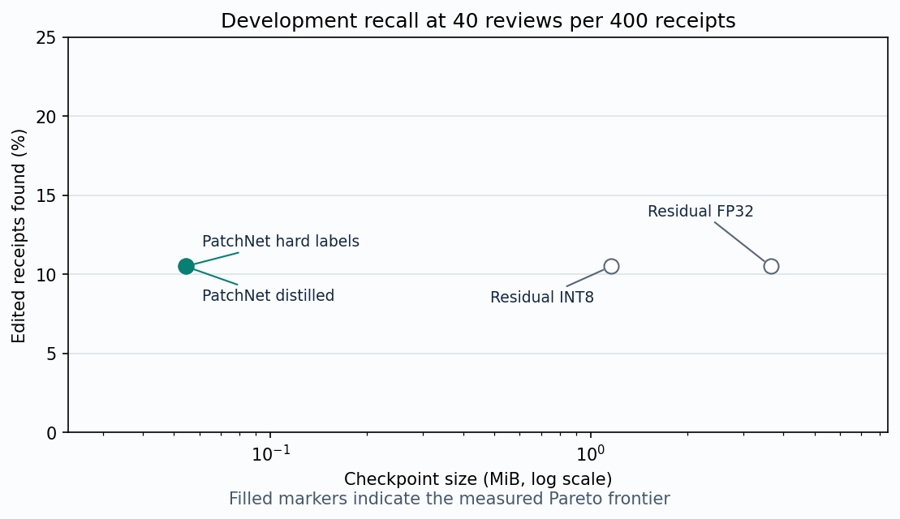
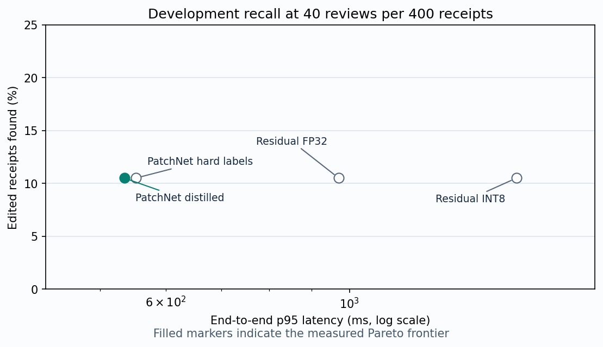

# Receipt detector latency and Pareto analysis

## Protocol

Run `receipt-pareto-v1` compares the frozen residual MobileNetV3-Small, its oneDNN static INT8 variant, and the two existing PatchNet checkpoints from `receipt-distill-v1`. The distilled PatchNet was trained with the earlier full-RGB teacher. Its results describe that existing student. The residual FP32 and INT8 comparison holds the parent checkpoint fixed. There was no retraining.

The benchmark uses all 400 contained development receipts from 199 groups, with 200 examples per class. The INT8 observer uses 16 deterministically selected calibration documents. Its Platt fit and review cutoff use the 290 calibration documents. FP32 and the students use their saved calibration values. The run locks checkpoints, policy values, and the scored receipt order before processing development images. The manifest's historical test and shift images are outside the timed and scored cohorts.

Timing starts at file open. It includes decode, EXIF orientation, RGB conversion, native tiling, model forward passes, top-three logit pooling, top-tile selection, probability calibration, the preview routing rule, and JSON serialization. The benchmark gives each model eight warm-up receipts, processes one document at a time with up to 64 tiles per forward pass, and rotates the model order across receipts. The measured CPU uses two PyTorch intra-op threads and one inter-op thread. Timing excludes application startup, model loading, network transport, and browser rendering. Checkpoint MiB measures serialized weights, including packed INT8 weights, and is independent of runtime memory.

For the **common review budget**, each system ranks the 400 development receipts by descending raw edit logit, takes the first 40, and breaks score ties by sample ID. This measures ranking under a fixed queue size. With 200 edits in the balanced cohort, 40 review slots cap recall at 20%. The timed response separately applies each model's calibration and the fixed research confidence gate. Pareto dominance compares measured point estimates. A design dominates another when it has at least as much recall and at most as much cost, with a strict advantage on at least one axis.

## Results on the AMD Ryzen 7 5800U

| Design | Median (ms) | p95 (ms) | Checkpoint (MiB) | Recall at 40 reviews | Edits found / false flags |
| --- | ---: | ---: | ---: | ---: | ---: |
| Residual MobileNetV3 FP32 | 156.46 | 970.29 | 3.65274 | 10.5% | 21 / 19 |
| Residual MobileNetV3 INT8 | 241.07 | 1,590.80 | 1.15876 | 10.5% | 21 / 19 |
| PatchNet with hard labels | 86.92 | 551.93 | 0.05434 | 10.5% | 21 / 19 |
| Distilled PatchNet | 86.28 | 534.57 | 0.05434 | 10.5% | 21 / 19 |

**The selected residual FP32 checkpoint misses the 100 ms median target.** Both PatchNet students meet it on this run, while their tail latencies exceed 500 ms. Each design finds 21 of 200 edits and falsely flags 19 of 200 genuine receipts at the common budget. Uniform random review would find 20 edits in expectation under the same budget. The observed difference of one edit is insufficient evidence of a useful review advantage.

**Size frontier.** Both PatchNet students tie in recall and checkpoint size, so both are on the frontier. INT8 reduces residual checkpoint size at the same observed recall, so it dominates FP32 on this axis. Both residual variants are dominated by the smaller students.

**Latency frontier.** Distilled PatchNet has the lowest measured p95 at the same observed recall. It dominates the other designs on this run. The hard-label student's p95 is close, so one pass cannot establish a repeatable latency advantage from distillation. Residual INT8 was slower than FP32 at both the median and p95. The benchmark does not isolate which operators or memory-layout changes caused the slowdown.





## Reproduce

Run from the repository root in the pinned [receipt CPU environment](SINGLE_IMAGE_REPRODUCTION.md#local-cpu-environment). Choose a new output directory for each repetition.

Bash

```bash
export OPENBLAS_NUM_THREADS='1'
python -m research.receipt_pareto --manifest artifacts/receipt-protocol-v1-contained/manifest.csv --root data/aiforge/assets --students artifacts/receipt-distill-v1 --output artifacts/receipt-pareto-v1 --cpu-label 'AMD Ryzen 7 5800U'
```

PowerShell

```powershell
$env:OPENBLAS_NUM_THREADS = '1'
python -m research.receipt_pareto --manifest artifacts/receipt-protocol-v1-contained/manifest.csv --root data/aiforge/assets --students artifacts/receipt-distill-v1 --output artifacts/receipt-pareto-v1 --cpu-label 'AMD Ryzen 7 5800U'
```

Run evidence is in `artifacts/receipt-pareto-v1/lock.json`, `summary.json`, `scores-and-timings.csv`, `int8-calibration.json`, and `verification.json` within the same directory. The lock records the saved INT8 weight digest and parent checkpoint fingerprint. Verification independently checked all 1,600 timed rows and found exact parity with the saved development logits for the three preexisting checkpoints. The checked-in figures contain only aggregate measurements.

## Random-review benchmark

Uniform selection of 40 documents without replacement from the 200 genuine and 200 edited development receipts gives a hypergeometric edit count. The expected count is 20, the central 95% range is 14 to 26, and the probability of finding at least the observed 21 is 0.434. This interval describes random queue selection conditional on this cohort. The observed count provides little evidence for a better queue than uniform review.

## Repeated timing on the fixed development panel

Three passes over the first 40 hash-ordered development documents produced 480 complete timings (four configurations per document per pass). Logits agreed with the stored development output within 0.0001. The rows use the same decode-through-JSON boundary; thread configuration changes occur outside the timing window.

| Configuration | Median ms by pass | p95 ms by pass |
| --- | --- | --- |
| Residual FP32, 2 threads | 135.56 / 126.75 / 131.36 | 716.69 / 984.05 / 767.85 |
| Residual FP32, 4 threads | 125.17 / 110.17 / 111.97 | 611.11 / 796.09 / 690.76 |
| Hard-label PatchNet, 2 threads | 72.62 / 68.78 / 68.36 | 402.26 / 548.66 / 389.01 |
| Distilled PatchNet, 2 threads | 71.28 / 70.09 / 68.95 | 381.02 / 541.47 / 389.32 |

The paired median per-document difference (distilled minus hard-label, taking the median within each document first) was -1.15 ms, source-group bootstrap 95% interval [-1.63, -0.18]. The last pass reversed the p95 ordering by 0.31 ms. This small panel quantifies run sensitivity; the original 400-document measurement remains the primary benchmark. Four threads improved all three residual medians but each still exceeded 100 ms.
